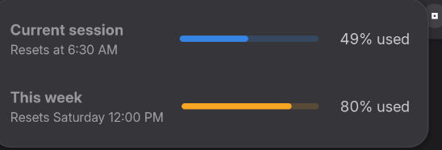

# Claude Usage for GNOME

A GNOME Shell extension that shows how much of your Claude usage limits you've used, as a single icon in the top bar.



- **Icon colour** shows whichever is closer to its limit, the 5-hour session or the week: green under 50% used, yellow from 50%, red from 80%
- **Click it** to see the current session and this week as bars, with when each one resets

Usage is read from Claude Code's local session logs (`~/.claude/projects`). Nothing is sent anywhere and no login is needed.

Requires GNOME Shell 50.

## Accuracy

The logs record tokens but not your plan's actual limits, so the percentages are **estimates**:

- Tokens are weighted like API pricing (output counts more, cache reads much less) and divided by a session and a weekly budget.
- The budgets were calibrated against one account's claude.ai usage page. Your plan may differ.
- Usage from claude.ai chats or other computers isn't in the local logs.

To match your own account, compare with [claude.ai/settings/usage](https://claude.ai/settings/usage) and adjust the constants at the top of `extension.js`:

| Constant | What it is |
|---|---|
| `SESSION_BUDGET` | Weighted tokens that count as 100% of a 5-hour session |
| `WEEK_BUDGET` | Weighted tokens that count as 100% of a week |
| `WEEK_RESET_DAY`, `WEEK_RESET_HOUR` | When your weekly limit resets (0 = Sunday, 6 = Saturday) |
| `YELLOW_FROM`, `RED_FROM` | Percentages (session or week, whichever is higher) where the icon changes colour |

If your percentage is too high, raise the budget by the same ratio (e.g. shows 60% but claude.ai says 40% → multiply by 1.5).

## Install

```bash
git clone https://github.com/voidrlm/gnome-claude-usage.git ~/.local/share/gnome-shell/extensions/claude-usage@arjun
```

Log out and back in, then enable it:

```bash
gnome-extensions enable claude-usage@arjun
```

## Update

```bash
git -C ~/.local/share/gnome-shell/extensions/claude-usage@arjun pull
```

Then log out and back in.

Not affiliated with Anthropic.
